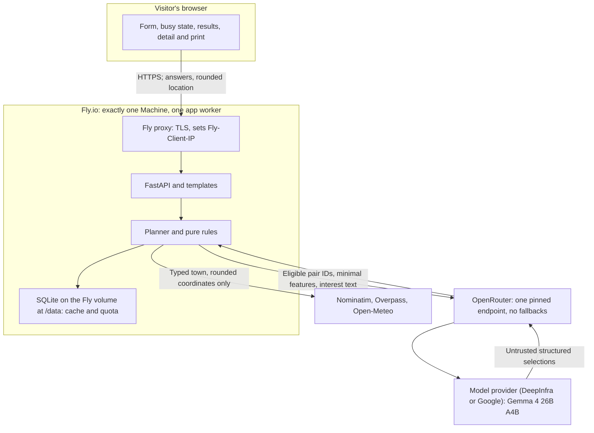
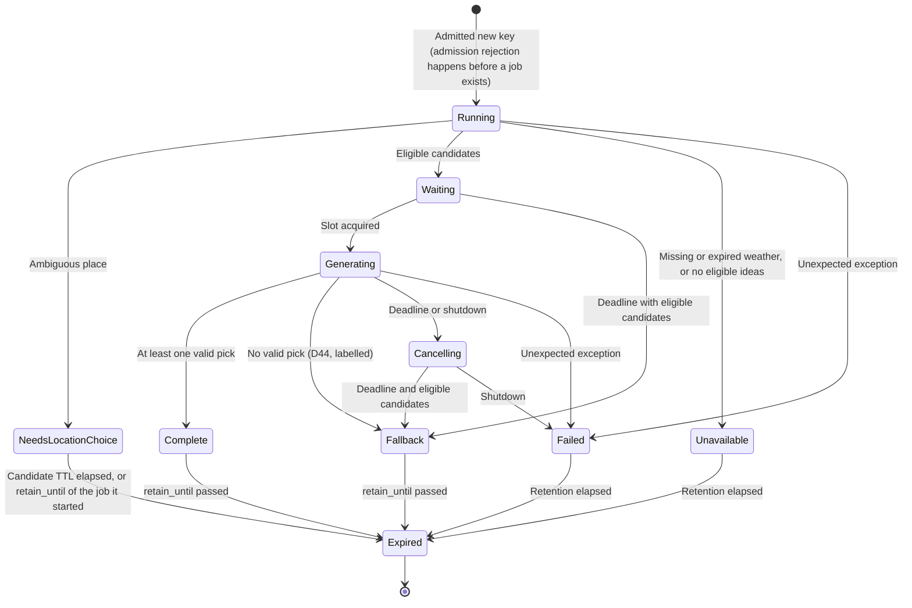
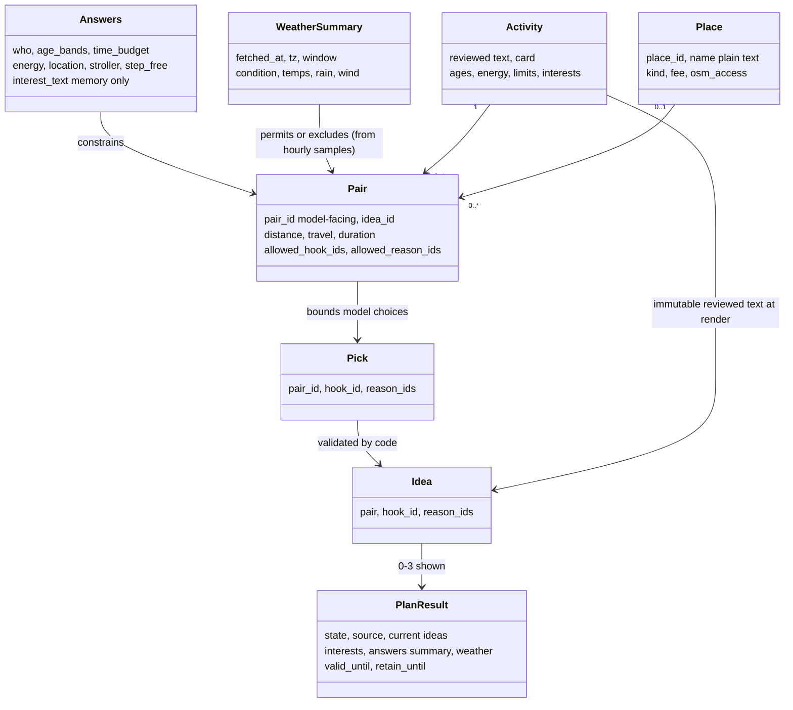

# Wiggle Outside architecture — baseline 8.20 (primary path: hosted, D48)

Status: **baseline 8.20, accepted specification**, 10 October 2026. Backend rules: [BACKEND-CONTRACT.md](BACKEND-CONTRACT.md). The build starts only after Mats's "kör".
Read with [ERROR-HANDLING.md](ERROR-HANDLING.md), [PLAN.md](PLAN.md) and [CLAUDE-REVIEW.md](CLAUDE-REVIEW.md). ([HERMES-P0.md](HERMES-P0.md) is a superseded appendix, TC-003.)
The diagrams describe intended behaviour, not verified infrastructure. Operational defaults below are accepted starting values (baseline 8.20); sections marked deferred or inactive are not built.

## 1. Scope and decisions

One modular FastAPI application, one application worker, one SQLite worker, one active model generation. Code owns eligibility; Gemma chooses supplied IDs; templates own display wording. No new distributed services, agent framework, vector database or task broker.

Freeze the product scope. Resolve contradictions through the decision register rather than adding alternatives throughout the plan. A design can be complete enough to implement without pretending that runtime behaviour has already been proved.

## 2. Deployment and trust boundaries

**Primary build path (round 8.19): the independently hosted public planner (D48, O2).**
Spending is not yet approved; the design does not depend on that approval.



What each outside party receives (and the privacy copy says the same):

| Recipient | Receives | Never receives |
|---|---|---|
| Fly.io (host) | every request, as the operator of the infrastructure | — |
| Nominatim (place search) | the typed town or area | ages, interests, energy, time |
| Overpass (places), Open-Meteo (weather) | rounded coordinates (2 dp) and fixed query parameters | the typed text, ages, interests |
| OpenRouter and the pinned model provider | the model prompt: pair IDs, activity IDs and titles, place kinds, distance bands, energy levels, the vocabulary and the optional interest text | anything the app deliberately puts in the structured inputs beyond that list: no place names, coordinates, typed town, session or network data |

The "never receives" column describes what the app deliberately sends. The interest text
is free text the visitor types, so it reaches the model provider exactly as typed; if a
visitor types a name, address or other personal detail there, it is sent too. The hint
therefore asks "Don't include personal details" (DESIGN-SPEC §9), and the text is never
logged, cached or stored by the app.

**Inactive alternatives** (kept for history; agents do not build them): O1, a local app
with a recorded video; O4, self-hosted E4B on a rented GPU; the public replay demo of
D24. **Local development** may use a local Ollama model (D38) for convenience; it is not
part of the product and does not gate the build or the release.

The build environment is not part of the application and is not drawn here (round
8.10). The build runs on Mats's own machine: Claude Code integrates, Codex reviews and
Mats approves and commits (BUILD-PACKAGES §2, TC-003). The tools actually used are
recorded in `docs/evidence/build-process.md` (PLAN §17).

### 2.1 Fly.io operating contract (round 8.19)

- **Exactly one Machine.** First deploy with `fly deploy --ha=false`; `fly scale count 1`
  if a second Machine ever exists. Fly creates two Machines by default for apps with
  services, but only one when a volume is mounted; we rely on neither default and assert
  the count after every deploy. Autoscaling off.
- **One app worker** (one uvicorn process). Deduplication, rate limits, the job registry
  and the quota assume one process and one database.
- **Volume:** one 1 GB volume mounted at `/data`; SQLite at `/data/wiggle.sqlite3`
  (cache and quota tables). Volumes persist across restarts and deploys and are not
  replicated; Fly's daily snapshots (kept 5 days by default) are the backup. Never
  scale with a second volume: data would not be copied.
- **Client address:** `Fly-Client-IP` from Fly's proxy; `X-Forwarded-For` is not trusted.
  Whether Fly overwrites a client-supplied `Fly-Client-IP` is a release proof obligation;
  until proven, the per-network limits are treated as best effort.
- **Restart:** the app reads the quota from SQLite on start (DEPLOYMENT §2.3); in-memory
  jobs, sessions and network counters are lost, which the contracts already allow.
- **Health check:** `GET /healthz` (no session, no counters, no provider calls) for
  Fly's check; excluded from the B2 limit (DEPLOYMENT §2.2).
- **Deploy and rollback:** a deploy replaces the image on the same Machine and keeps the
  volume; with one Machine there is a short gap, which is accepted. Rollback redeploys
  the **previously verified image by its digest** (`fly deploy --image
  <registry>@sha256:…`, recorded in `docs/evidence/release.md`), never a mutable tag.
  Schema changes to the quota table
  are additive only, so rollback never loses the count.
- **Secrets:** the OpenRouter key as a Fly secret; never in `fly.toml`, the image or the
  repository.
- Files: `fly.toml` and `Dockerfile` are owned by WP9 (BUILD-PACKAGES), reviewed by Mats.
- **Release checks (WP9, `docs/evidence/deploy.md`):** `fly machine list` shows one
  Machine; the quota count is unchanged across a restart, a deploy and a rollback; a
  spoofed `Fly-Client-IP` header is not used; the key is absent from the image and logs.

## 3. Request sequence

```mermaid
sequenceDiagram
  participant B as Browser
  participant W as Web boundary
  participant P as Planner
  participant X as Providers
  participant M as Model
  B->>W: POST validated form and idempotency key
  W->>W: CSRF, body limits, ownership and duplicate check
  W->>P: Start once with absolute deadline
  P->>X: Resolve location if needed
  X-->>P: Coordinates or typed failure
  par Places lookup
    P->>X: Places with bounded timeout
    X-->>P: Places or unavailable
  and Weather lookup
    P->>X: Weather with bounded timeout
    X-->>P: Weather or unavailable
  end
  P->>P: Validate weather, then daylight (family path)
  alt Family run outside daylight (BACKEND-CONTRACT 1)
    P-->>W: Fixed daylight copy; no further rules, no model call
  else Daylight holds or solo path
    P->>P: Apply weather and eligibility rules
  end
  alt Weather unavailable or no eligible activities
    P-->>W: Explain unavailability; no model call
  else Eligible pairs available
    P->>P: Wait within deadline for single model slot
    P->>M: Schema and allowed pairs, hooks and reasons
    M-->>P: Structured selections or failure
    P->>P: Validate once; no repair (D44)
    P-->>W: Valid result or eligible deterministic fallback
  end
  W-->>B: Render reviewed content and honest source labels
```

Geocoding must precede coordinate-based provider queries. Provider errors are isolated; cancellation is propagated, not swallowed as an ordinary provider failure. An unavailable forecast always stops recommendations, including generic and deterministic paths.

One monotonic absolute deadline covers geocoding, providers, queueing and generation. The user-visible budget is 20 seconds (D32, accepted working default). Reserve a small bounded allowance inside that budget for fallback validation/rendering. Each stage receives only the remaining budget. Provider timeout values and queue capacities are recorded before lock and checked against the early measurements; retries never reset the deadline.

If upstream data is ready but inference cannot finish in time, return eligible deterministic picks. If required data is missing, return unavailability. Cleanup may outlast the response, but the model slot cannot be reused while its previous generation is still running.

## 4. Request state and ownership



Choosing a location candidate starts at most one new job per candidate (BACKEND-CONTRACT §3).
Between `valid_until` and `retain_until` a Complete or Fallback result is displayed as
historical; that is a presentation of the same state, not a separate state (BACKEND-CONTRACT §2). Result validity,
resource bounds and the startup/shutdown rules are in BACKEND-CONTRACT §2, §4 and §10.

### Lifecycle contract

- The browser's POST waits for the job; it does not own the computation. If the response is lost, the job continues only until its original deadline. Resubmitting the same form (same idempotency key, same answers) joins the running job or returns its result and never launches another model request (D43).
- There is no user-facing cancellation in v1 (D43). Internal cancellation remains: at the deadline, at shutdown, and when the last waiter of a shared fetch leaves. The `Cancelling` state exists only for that cleanup.
- An opaque idempotency key is scoped to the browser session and normalized input. Same key/same input joins or returns the existing result. Same key/different input is rejected. No global result lookup by an unowned ID.
- Completed keys expire; expired requests require an explicit new submission and new key. A restart loses transient jobs and returns a retry explanation, not a false completed result.
- Limits (starting values): 5 active/admitted requests including the current generation, 100 terminal request records, terminal TTL 5 minutes, 32 KiB serialized result cap. Reject admission when bounded storage cannot safely accommodate it; never evict active work to admit more work. Validate the values with five-client testing.
- Transient answers and cards remain in process memory only for the documented lifecycle. Logs, SQLite and public evidence do not retain them. No promise of forensic erasure from process memory or host swap is made.
- Completion, cancellation and expiry transitions are atomic within the single event loop. Test races between cancellation, response completion and retry.

The state machine describes user-visible results. Model-slot ownership is a separate resource invariant, and it differs by model backend (round 8.16). **Local model (optional development only; never the product):** hold the slot until completion or verified cancellation; if cancellation cannot be confirmed within the cleanup budget, mark the model unavailable, reject new model jobs and use eligible fallbacks until supervised recovery; never stop other models on the machine. **Hosted model (O2):** the slot limits open requests from the app to one and is released when the connection closes; a closed request may still be generating and billable at the provider, so the app makes no claim about remote generations; the bounds are the daily allowance, the timeout and the key cap (DEPLOYMENT §3).

### Transport contract (D43, round 8.11)

One transport for both paths: POST `/plan` waits for the job's terminal state, then
answers 303 to `/results/{job_id}`. Without JavaScript the browser follows it. With htmx
the same request shows the busy state immediately, follows the redirect and swaps the
result region (how htmx 4 handles the redirect is a proof obligation, with the CSP). No
progress stream, no polling, no second workflow. Nothing about the answers appears in a
URL.

## 5. Domain relationships



Use frozen dataclasses with immutable nested values for domain values. Pydantic belongs at external validation boundaries; domain objects need not inherit it. Protocols express actual replaceable capabilities, and are generic only when required. The diagrams do not prescribe a class or file for every label.

Catalogue validation checks unique IDs, known enums, age/energy sets, finite ordered duration/weather ranges, required content, placeholder-free hook text and per-pair hook/reason compatibility. TOML `when` strings are explanatory documentation, never executable predicates. Generic eligibility needs explicit reviewed criteria; absent destination does not erase activity requirements. Resolve seasons by location/hemisphere or explicitly restrict the supported geography; do not silently assume autumn globally.

## 6. Lean dependency inventory

| Group | Initial inventory | Purpose |
|---|---|---|
| Application | fastapi, uvicorn, pydantic, httpx, jinja2, python-multipart | Web boundary, server, validation, outbound HTTP, templates, form parsing |
| Standard library | sqlite3, tomllib, dataclasses, asyncio, concurrent.futures, logging | Persistence, catalogue parsing, values, lifecycle and diagnostics |
| Browser/build | htmx if required; Tailwind and its chosen build integration; small external JS | Progressive enhancement and styles |
| Development/security | Existing approved linters, tests and scanners | Quality evidence; excluded from runtime image |
| Analysis | pandas, Polars, DuckDB | Offline comparison only; excluded from runtime image |

This inventory is accepted (D23); exact versions, direct imports, extras and transitive closure are pinned and audited during bootstrap. Use base dependencies rather than broad convenience extras unless their features are needed. Existing httpx handles Ollama; no extra SDK by default. Alpine, uvloop, ORM, Redis, Celery, RAG, vector database and orchestration framework require a demonstrated need before addition. Do not implement custom crypto, cookie signing or parsers to satisfy a package-count target.

Record each dependency's purpose, version, source, licence, runtime/build/analysis group and why the standard library is insufficient. More than eight direct runtime dependencies triggers an explicit reviewed dependency-budget decision, not disguised transitive imports or an unreviewed bypass. Compile a small production asset bundle; do not ship build tools or analysis notebooks in the runtime image.

## 7. Concurrency, persistence and resource budgets

- One application worker is an enforced v1 deployment property. Increasing workers requires a new design for shared rate limits, idempotency and model admission.
- Place and weather I/O overlaps after location resolution. SQLite uses one owned executor thread; connection creation, use and closure happen there. Queue size and shutdown are bounded. No database transaction remains open during network or model work.
- Reuse a bounded HTTP pool. Set connect/read/pool deadlines, decompressed response-size caps and a bounded redirect policy. Provider endpoints are configuration-controlled, never supplied by users. Upstream 429s respect provider policy; no unbounded immediate retries.
- Nominatim pacing is application-wide, not per request. If it cannot run within the remaining deadline, return an honest retry result. Identical in-flight provider lookups may share work; one subscriber cancelling must not cancel work still needed by others.
- Cache budgets (starting values): at most 1,000 records, at most 1 MiB per serialized entry and a 64 MiB storage budget. Expired-first then least-recently-used eviction. Include SQLite database, journal/WAL and temporary space in disk accounting. If storage cannot fit an entry, bypass caching rather than fail a valid request. Exact enforcement and compaction strategy require review before lock.
- Preserve existing provider TTLs, but also validate that cached weather covers the entire requested interval. Record source timestamps and distinguish fetch time from forecast validity.
- **Local model endpoint (development only, D38; TC-003, re-homed from HERMES-P0 section 4):**
  a local Ollama instance stays bound to host loopback and is reachable only from the
  machine running it. Only the generation endpoint for the pinned model is used, with
  `num_ctx` 4096 and `num_predict` 256. It gates nothing and never serves the product.
- Cache keys include provider and query/schema version. Cache migrations may discard/rebuild disposable data. Optional feedback, if enabled, must be kept separately and never silently discarded during a cache reset.

## 8. Offline card, connectivity and accessibility

Connectivity is stated once in DEPLOYMENT §3: valid cached provider data during an outage, a printed or saved card offline, and the app itself needs internet.


v1 meaning of offline card: a fully rendered, already-open card remains readable without network, and print/save-to-PDF is supported by the browser. Offline reload, service workers and downloadable HTML are not included. Verify offline readability after network loss and local assets finish loading. State this precise behaviour in UI/help; do not promise general offline planning.

The hosted planner is used directly on phones; the outdoor trial uses it or a printed or saved card. Preserve keyboard focus, input values and error summaries on retry. Progress announcements must not repeatedly steal focus. Test the enhanced and plain-form journeys against the same acceptance properties.

## 9. Quantization and measurement

*Inactive for the hosted product (round 8.19): this section applies only to local development or the inactive O4. The hosted product measures the pinned hosted model instead (latency, invalid-output rate, `usage` tokens; DEPLOYMENT §3).*

Quantization means reduced numerical precision for model weights, not quantum computing. Compare two supported quantizations of the same model only after proving the baseline model runs on the actual GPU/runtime. Never assume the RX 6800 backend works because model loading succeeded on CPU.

Use identical reviewed scenarios, candidate features, schema, context/output limits and generation settings. Record model/source digest, quantization, runtime/backend/driver versions, prompt/catalogue/hooks versions and machine state. Compare valid selection rate, blinded ranking preference, invalid-output and fallback rates, median and tail latency, cold/warm latency, peak RAM/VRAM. Repeat scenarios enough to expose variance; small samples are exploratory, not statistical proof.

Choose the smaller model representation only if it meets agreed correctness and quality criteria. Compact inputs and a small output schema come first. No fine-tuning, speculative decoding or custom quantization pipeline in v1 without a measured need and a separate scope decision. Use supported Ollama schema-constrained output plus application validation. Low temperature is not a guarantee of deterministic or correct output.

(Development only; product figures come from the hosted model.) Benchmark with any other local model stopped and, separately, with representative contention. Do not benchmark concurrently with dependency installs or unrelated GPU jobs without labelling that condition. Never claim a configuration is faster without retained measurements.

## 10. Architectural tests and observability

Properties apply to eligibility before ranking/capping unless stated otherwise:
- Increasing the energy ceiling cannot remove otherwise eligible activities.
- Adding an age band cannot add incompatible activities.
- No model output can introduce an unsupplied pair, hook or reason.
- Missing/stale/interval-incomplete weather cannot reach recommendations through a fallback.
- Concurrent duplicate submissions start at most one generation for the same owned key.
- Cancellation/timeout cannot admit overlapping model work while the previous work remains active.
- Released catalogue/hooks bytes match the tested artifact.
- Snapshot and commit source inventories match, including new files and deletions.

Additional failure scenarios: full queue, response lost while the POST waits (resubmission joins), internal cancellation at the deadline and at shutdown with model-slot release only after verified cancellation, process restart, slow geocoder, 429 provider response, malformed/oversized upstream body, SQLite full/unavailable, model out-of-memory, graceful shutdown and failed candidate deployment. Tests may use fixtures; real-provider/runtime evidence is recorded separately.

Standard structured logs record opaque request IDs, stage durations, queue delay, cache outcomes, validation/fallback reason codes and total time. No prompts, answers, coordinates, typed place queries or raw provider bodies. Configure web-server/access logs and traces consistently; dependency debug logging must not undermine the application policy. No telemetry service is needed for v1.

## 11. Release, recovery and open decisions

Retain the last verified artifact, its configuration schema and inventories. A release uses the exact tested digest; verify the actual public hostname after promotion too, because proxy/domain configuration can differ from the candidate. On failure roll back the artifact and compatible configuration. Cache can rebuild; optional feedback requires its own migration/backup decision. At the first release there is no prior artifact, so the recovery action is take down the failed candidate, not invent a rollback target.

Before lock, resolve these items in PLAN's decision register: public-demo mode, browser entry point, operational limits/deadlines, job lifecycle/transport, cache eviction, Python/runtime versions, security configuration and review of catalogue/weather limits. Exact package versions and control effectiveness are bootstrap evidence requirements, not fictional completed decisions.

Sources consulted for technical direction: [FastAPI forms](https://fastapi.tiangolo.com/tutorial/request-forms/), [Ollama structured output](https://docs.ollama.com/capabilities/structured-outputs), [Ollama operational FAQ](https://docs.ollama.com/faq). Recheck compatibility for pinned versions during bootstrap.

## 12. Error-handling integration

ERROR-HANDLING.md is the shared backend/frontend failure contract. Adapters translate
expected external failures; core/planner return typed outcomes; web maps these to HTML
or optional problem details. Unexpected exceptions use a safe boundary handler rather
than masquerading as an empty result. Plain and enhanced forms share the same rules.

Every terminal state restores usable controls and offers a truthful recovery action
where one exists. Reconnection joins existing work; uncertain POST results do not launch
new work. Client cancellation status and model resource cleanup remain distinct. Tests
cover status, text, focus/announcement, retention, side effects and diagnostic privacy.

This contract adds no queue broker, telemetry vendor or error-handling framework. It
preserves the competition window, fixed demo disclosures and evidence-based claims.

## 13. Round 8.3 resolutions (merged from the 8.2 review)

### 13.1 Deadline budget (D32, accepted)
Geocode 3 s → places and weather concurrently 4 s → queue and model 11 s (no repair, D44) →
2 s reserved for fallback assembly and rendering. Each stage receives
`min(stage budget, time remaining)`; retries never reset the deadline. Validated against
the Saturday smoke test before lock.

### 13.2 Session, CSRF and transport (D31, accepted)
`__Host-tg_session`: random opaque ID, Secure, HttpOnly, SameSite=Strict, Path=/, no Domain,
mapped to server-side state holding the CSRF token and owned job IDs (bounded by section 4).
Every form, plain or enhanced, carries the token; comparison uses `hmac.compare_digest`;
Origin is checked. htmx 4 (core only; the `hx-sse` extension is not used since D43); status
the server returns full pages only and htmx swaps `<main>` from each (`hx-select`);
`hx-status` lets 4xx and 5xx swap too, so an error page replaces stale results and never
lands inside the results list (round 8.12; CONTRACTS §3), as ERROR-HANDLING section 5
requires. No `hx-on`, event
filters or `js:` values. htmx's indicator CSS arrives as a constructable stylesheet outside
`style-src`; this is documented library behaviour and our indicators use our own CSS.
Script tags carry build-time SHA-384 `integrity` attributes.

### 13.3 Canonical audit procedure
This is the only audit procedure; PLAN section 8 refers here.

**Audit runner (TC-003, re-homed from HERMES-P0 section 2):** the configuration that runs
the steps below. It reads the lockfiles only, holds no credentials, reaches advisory
sources only (PyPI, api.osv.dev, the npm advisory endpoint, the GitHub advisory API and
the Trivy database host), installs nothing and executes no project code. In CI this is
the `supply-chain` workflow job.
1. Python inventory: `uv export --frozen --all-groups --all-extras --no-emit-project
   --format requirements-txt` (hashed, no editable project line).
2. `pip-audit --strict --require-hashes --disable-pip -r <export>`: no resolution, no install.
3. `bun audit` against `bun.lock`.
4. OSV-Scanner against `uv.lock` and `bun.lock` (catches GHSA/PYSEC IDs without CVEs).
5. `trivy image --input <archive>` for the demo image's OS packages.
6. Coverage: each scanner's package identities are compared with the inventory for its own
   scope; counts across ecosystems are never compared. Empty, missing or unsupported
   coverage fails. A stale or unreachable database means "not verified".
Evidence shows the export covers every declared group and that the audit runner made no
package downloads and ran no project code. Scanner versions are pinned in bootstrap.
At release, step 5 runs on the exact image archive that will be deployed, identified by
digest, with a vulnerability database at most 24 hours old (PLAN section 8 release gate).

### 13.4 Generic suggestions and seasons (D30)
Only activities with `generic_ok = true` may pair with an absent destination; age, energy,
weather, daylight, season and time rules still apply. Seasons follow D30.

## 14. Request budget (D33, mandatory)

Every outbound request has a purpose and a bound. Validation runs before any provider call.

| Trigger | Allowed upstream work |
|---|---|
| Page load, typing, focus, hover, quiz option taps, resizing, opening or printing a card | none |
| "Use my location" | one browser geolocation prompt; no server call until submit |
| Invalid or incomplete submission | none |
| Valid submission, cold caches | ≤ 1 geocode (typed place only), 1 places, 1 weather, 1 model call |
| Valid submission, warm caches | the cache hits remove their calls |
| Weather missing or stale, or no eligible candidates | 0 model calls |
| Duplicate submission, double click, resubmission after a lost response | 0 additional upstream calls; joins the existing job |
| "Change answers" resubmission that changes only the interest text, with the same carried coordinates and the same time budget, while the cached weather is fresh and covers the new window (D46) | only the model call |
| **Every "Change answers" resubmission (TC-002)** | the counts in this table are *upstream calls*, not checks. A resubmission is a new job and re-runs every pure check — daylight, the weather limits, eligibility, season and time — against its own `planned_start` and window, on cached data where the caches still cover it. Re-running adds 0 calls, so no count here changes |
| "Change answers" with a different place, a different time budget (it changes the places radius and the window), or expired weather | the calls whose cache keys or coverage changed: geocode for a newly typed place, places for a new location or radius, weather for a new location or an expired or non-covering entry; then the model call |
| Redisplay of a completed result within its TTL | 0 upstream calls |

Exceptions are counted and bounded: no model repair (D44); provider
retries owned by the provider wrapper only (8.9): at most one, after `TransportFailure`,
inside the stage budget, and each attempt passes the provider gate (BACKEND-CONTRACT §6).
Adapters never retry; no layer above the wrapper retries a provider. No progress stream
and no polling (D43).

CI asserts these counts: respx call counters per provider and for the model adapter in planner and
web tests, and Playwright network inspection for the browser rows. Counters for cache hits,
upstream calls and duplicate work prevented are logged by stage, with no answers,
coordinates or place queries.

## 15. Cache contract (D33)

| Cache | Scope | Key (all inputs that affect the result) | Freshness |
|---|---|---|---|
| Geocode | shared public data | provider, normalised query, language, schema version | 30 days |
| Places | shared public data | provider, rounded lat/lon (2 dp), radius, kinds, schema version | 7 days |
| Weather | shared public data | provider, rounded lat/lon, variables, schema version; entry must cover the whole outing window | 30 min |
| Results | private, per session | session ID, idempotency key, normalised input hash | `retain_until` (BACKEND-CONTRACT §2); memory only |

- Private results are never shared or looked up across sessions; deduplication never
  exposes one user's result to another.
- Concurrent misses for the same key share one in-flight fetch (single flight). The fetch
  task is owned by the cache, so one waiter cancelling does not cancel it for others.
- Fetch ownership, deadlines, outcome classes and provider cooldowns follow BACKEND-CONTRACT §6.
- A failed provider call is negatively cached for 60 s per key so failures cannot flood
  providers; Nominatim pacing (1 request/s) is application-wide.
- Bounds from section 7 apply (1,000 records, 1 MiB per entry, 64 MiB including WAL);
  expired first, then least recently used. If the cache is unavailable or full, requests
  bypass it but still obey the request budget and rate limits.
- Schema-version bumps invalidate entries; the cache is disposable and rebuilds.
- No many-user capacity claim without measurements; shared infrastructure only if a
  measured need justifies it.

## 16. Optional intent preloading (D34, **deferred**: not in v1)

Allowed only for small, allowlisted same-origin static UI assets, after a deliberate hover
or keyboard focus (suggested 200 ms, to be measured), with a byte cap and no mobile
long-press hijacking. It never geolocates, calls providers or runs Gemma. While the quiz
is a single page with all steps loaded, no preloading is needed.

